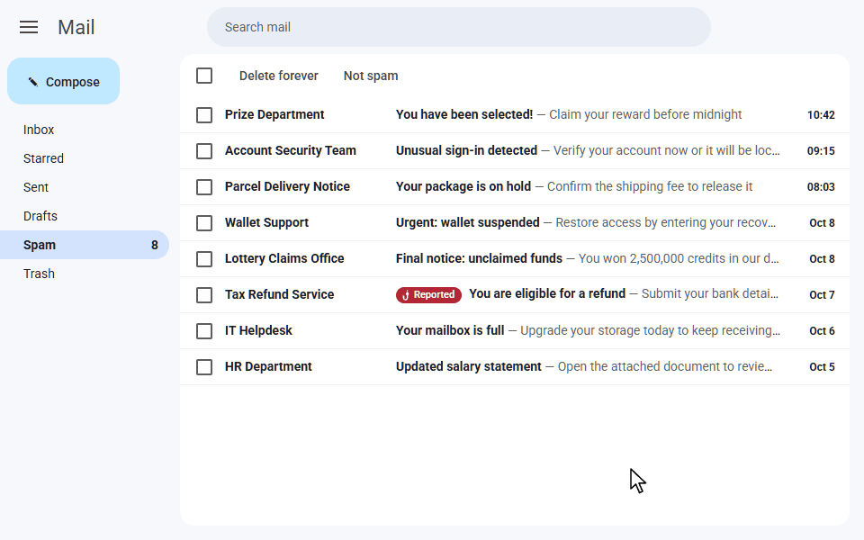
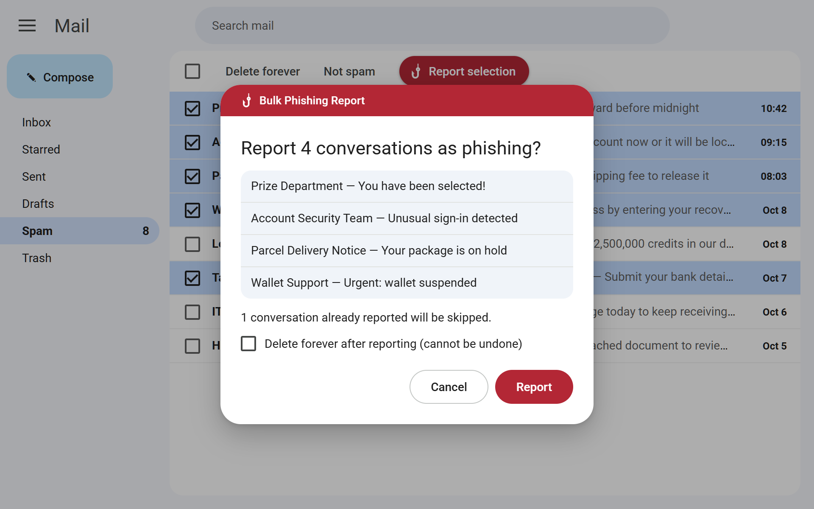
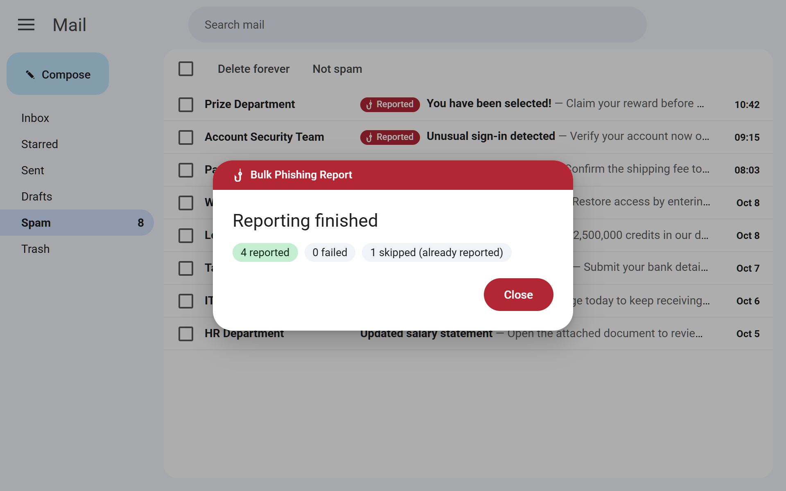

# Bulk Phishing Report for Gmail

[Features](#features) · [Install](#install) · [Disclaimer](#disclaimer) · [License](#license)

Reporting phishing to Google trains Gmail's filters and protects other users, not just you. But Gmail hides
"Report phishing" in the ⋮ menu of each message: one conversation at a time, several clicks each. With dozens of
scams in the Spam folder, few people bother: they just delete them.

This Chrome extension adds a **Report selection** button to the Spam folder: check the conversations, click once, and
each one is reported through Gmail's own "Report phishing" action.

## Features

- A confirmation lists the conversations before anything is reported.
- Conversations already reported are marked and skipped.
- Optional: delete forever after reporting (unchecked by default).
- **Dry-run mode** (toolbar icon): goes through every step without reporting or deleting anything.
- English or French, following Gmail's language.
- Only the `storage` permission and no network access: reports go through Gmail's own action.

| Confirmation | Summary |
|---|---|
|  |  |

## Install

Works in Chrome and other Chromium-based browsers.

1. Download the `.zip` of the [latest release](https://github.com/sponsCA/bulk-phishing-report-for-gmail/releases/latest)
   and unzip it (or clone this repository).
2. Open `chrome://extensions` and turn on **Developer mode**.
3. Click **Load unpacked** and select the folder that contains `manifest.json`.
4. Reload Gmail.

Tip: try it first in dry-run mode, from the extension's toolbar icon.

## Disclaimer

Not affiliated with or endorsed by Google; Gmail is a trademark of Google LLC. Reports and permanent deletions cannot
be undone. The extension relies on Gmail's interface and may stop working when it changes. Provided without warranty.

## License

Copyright (C) 2026 Sébastien Pons

This program is free software: you can redistribute it and/or modify it under the terms of the GNU General Public
License as published by the Free Software Foundation, either version 3 of the License, or (at your option) any later
version. See [LICENSE](LICENSE).
